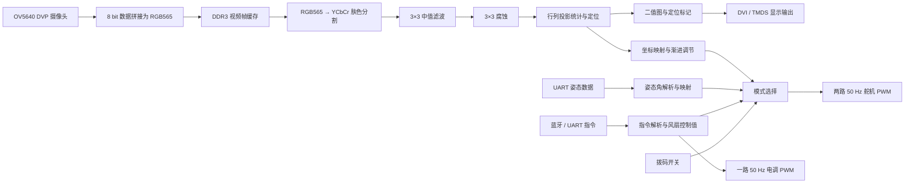

# 基于 FPGA 的多轴姿态控制与人脸跟随风扇系统

**Multi-Axis Attitude-Controlled Face Tracking Fan System**

基于 Tang Mega 60K / GOWIN FPGA 的风扇控制工程，使用 Verilog 实现摄像头图像处理、目标位置估计、双轴舵机控制、蓝牙串口交互与姿态跟随。OV5640 采集的图像经过 DDR3 帧缓存、肤色分割和去噪后，生成目标坐标，并通过 PWM 调整风扇朝向；处理结果通过 DVI/TMDS 接口输出。

当前视觉方法是 **YCbCr 肤色阈值分割 + 行列投影定位**。它估计的是主要肤色区域的位置，适合受控背景下的单人跟随演示；没有使用人脸身份识别或深度学习检测模型。

## 功能概览

- **视觉跟随**：RGB565 图像输入、肤色分割、3×3 中值滤波、腐蚀、行列统计与目标坐标输出。
- **姿态跟随**：通过 UART 接收姿态角，映射为俯仰和水平舵机控制量。
- **蓝牙控制**：通过单字节 ASCII 指令控制双轴舵机、风扇电调，以及视觉跟随开关。
- **视频显示**：标称 1280×720、60 Hz 输出，显示二值图、红色定位十字线和黄色范围框。
- **硬件数据通路**：摄像头配置、RGB565 数据拼接、DDR3 帧缓存、PLL 和 DVI 发送均在 FPGA 中完成。

本文以 [工程文件](cam2dvi.gprj) 中启用的源码和 [顶层模块](src/top.v) 实际连线为准。当前文档整理完成了静态源码核对，未重新进行综合、时序验证或实板测试。

## 系统结构



第二级中值滤波 `u2_Median` 虽然在顶层实例化，但它的输出没有接入后续腐蚀模块；当前有效路径只经过 `u1_Median`。`Dilate` 和 `face_box_denoise` 也没有接入此主路径，因此不能将当前处理流程描述为完整闭运算或连通区域检测。

## 硬件与开发环境

| 项目 | 当前工程配置 / 复现要求 |
|---|---|
| FPGA 平台 | Tang Mega 60K，使用与约束相匹配的底板和外围连接 |
| 器件 | `GW5AT-60B`，型号 `GW5AT-LV60PG484AC1/I0` |
| 系统时钟 | 50 MHz，顶层输入 `clk` |
| 复位 | `rst_n`，低电平有效 |
| 摄像头 | OV5640，8 bit DVP，RGB565 输出，24 MHz 外部参考时钟 |
| 图像尺寸 | 1280×720 |
| 视频输出时钟 | 像素时钟 74.25 MHz；TMDS 串行时钟 371.25 MHz |
| 帧缓存 | 板载 DDR3，16 bit 物理数据总线，工程内含控制器及帧缓存 IP |
| 执行机构 | 双轴舵机、匹配电机的电调及独立供电 |
| 蓝牙 / 调试串口 | UART，约 9600 baud，8N1，无流控 |
| 姿态传感器 | UART，约 115200 baud，8N1，输出下文规定的数据帧 |
| 开发工具 | 建议从 GOWIN EDA V1.9.12 开始复现；现有约束文件由此版本生成 |

工程包含 Gowin 生成的 PLL、DDR3、FIFO、帧缓存和 DVI IP，部分文件为加密 HDL。请使用支持目标器件与这些 IP 的 GOWIN 工具及相应授权。板卡支持版本、驱动和下载方式可参考 [Sipeed Tang Mega 60K 文档](https://wiki.sipeed.com/hardware/en/tang/tang-mega-60k/mega-60k.html)。

### 主要外设引脚

下表来自 [NEO_DOCK.cst](src/NEO_DOCK.cst)。这些是 **FPGA 封装管脚名**，不是底板排针序号；接线前应结合实际底板原理图确认。

| 顶层信号 | FPGA 管脚 | 用途 |
|---|---|---|
| `clk` | V22 | 50 MHz 时钟 |
| `rst_n` | AA13 | 低有效复位 |
| `switch1` / `switch2` | C15 / E14 | 模式选择，逻辑顺序为 `{switch1, switch2}` |
| `rx_blue` / `tx_blue` | F15 / F16 | 蓝牙 / 串口接收、回显发送 |
| `rx_atk` / `tx_atk` | E16 / U15 | 姿态串口接收、回显发送 |
| `pwm_out1` | D19 | 俯仰 / 上舵机控制 |
| `pwm_out2` | C20 | 水平 / 下舵机控制 |
| `pwm_out` | F19 | 风扇电调控制 |
| `cmos_xclk` / `cmos_pclk` | AA21 / AB20 | 摄像头参考时钟、像素时钟 |
| `cmos_scl` / `cmos_sda` | AA14 / Y13 | 摄像头配置接口 |
| `cmos_vsync` / `cmos_href` | Y21 / AB21 | 摄像头同步信号 |
| `cmos_rst_n` / `cmos_pwdn` | Y22 / AB22 | 摄像头复位、掉电控制 |

摄像头数据总线、DDR3 和 TMDS 的完整分配见约束文件。部分信号采用 1.5 V I/O 配置，例如 `rst_n`、`cmos_sda`，不能将整组接口一概视为 3.3 V。UART 收发需交叉连接，控制板与外设共地；舵机和电机由合适电源供电，FPGA 管脚只输出控制信号。

## 快速开始

本工程的启动过程是：**打开工程 → 综合 → 布局布线 → 下载位流 → 选择模式**。

### 1. 获取工程

```powershell
git clone https://github.com/PengzhanDu/Multi-Axis-Attitude-Controlled-Face-Tracking-Fan-System.git
cd Multi-Axis-Attitude-Controlled-Face-Tracking-Fan-System
```

### 2. 打开与检查工程

1. 启动 GOWIN EDA，打开根目录的 `cam2dvi.gprj`。
2. 确认器件是 `GW5AT-60B / GW5AT-LV60PG484AC1/I0`，顶层为 `top`，对应 `src/top.v`。
3. 确认 `src/NEO_DOCK.cst` 与 `src/TMDS_60HZ.sdc` 已加入工程。
4. 确认 PLL、DDR3、帧缓存、FIFO、DVI 等 IP 文件能被工具识别。需要重新生成时，使用对应目录内的 `.ipc` 配置，并保持端口、器件和时钟设置一致。
5. 正常摄像头运行保留顶层默认参数：

   ```verilog
   parameter USE_TPG = "false";
   parameter DDR_BYPASS = "false";
   ```

使用 `.gprj` 内的文件列表，不要将所有 `.v` 文件递归加入工程：`src/img_box copy.v` 和 `src/absolute/path/to/img_box.v` 也声明了 `img_box`，但没有被当前工程启用，全部加入会产生重复模块定义。

### 3. 编译生成位流

在 GOWIN EDA 的流程面板中依次执行综合（Synthesis）和布局布线（Place & Route），检查错误、关键警告和时序报告。

当前工程的位流输出位置为：

```text
impl/pnr/cam2dvi.fs
```

目录中已有的 `.fs`、`.bin` 和报告属于历史生成文件；修改 RTL 后应重新生成位流，不能仅凭文件存在判断它与当前源码一致。

### 4. 下载到开发板

1. 按实际底板连接摄像头、显示器、UART 和控制信号，先在不带电机负载的情况下核对控制输出。
2. 给开发板供电，通过支持 JTAG 下载的数据线连接电脑，并安装对应驱动。
3. 打开 Gowin Programmer，扫描确认目标器件，选取本次生成的 `impl/pnr/cam2dvi.fs`。
4. 开发调试可使用适用于该器件的 SRAM 下载操作，按工具提示完成下载。SRAM 配置在掉电后丢失。
5. 如需上电自动运行，使用板卡文档规定的外部 Flash 下载流程。Tang Mega 60K 的 Flash 操作与 Programmer 版本有关，具体以 [板卡官方说明](https://wiki.sipeed.com/hardware/en/tang/tang-mega-60k/mega-60k.html#7-getting-started) 和 [Gowin Programmer 手册](https://cdn.gowinsemi.com.cn/SUG502E.pdf) 为准。

### 5. 选择控制模式

模式由 `servo_control.v` 中的 `{switch1, switch2}` 决定。下表为信号逻辑电平，实际拨码开关的 ON/OFF 与电平关系需按底板接线确认。

| `switch1` | `switch2` | 行为 |
|---|---|---|
| 0 | 0 | 居中模式：上舵机控制值 500，下舵机控制值 750 |
| 0 | 1 | 姿态跟随：俯仰与偏航数据控制双轴舵机 |
| 1 | 0 | 当前落入默认分支，双轴居中；独立摄像头分支在源码中被注释 |
| 1 | 1 | 蓝牙 / 视觉模式：`face_flag=0` 为手动控制，`face_flag=1` 为视觉跟随 |

**启用视觉跟随：** 将开关设为逻辑 `11`，在蓝牙 / UART 端发送小写字符 `j`。发送 `k` 返回手动控制。上电时 `face_flag` 初值为 0，仅拨到 `11` 不会自动进入视觉跟随。

风扇电调控制值来自蓝牙模块，独立于舵机模式选择。切换到 `00` 只会让舵机居中，不会自动清除风扇控制值。

## 蓝牙 / UART 指令

连接 `rx_blue` / `tx_blue`，串口设置为 **9600 baud、8 数据位、无校验、1 停止位、无流控**。协议直接接收小写 ASCII 字符；发送 `j` 就是发送字节 `0x6A`，不需要额外包头或换行。FPGA 会回显收到的字节，可用来检查链路。

| 字符 | HEX | 功能 |
|---|---|---|
| `a` | `61` | 上舵机控制值增加 10 |
| `b` | `62` | 上舵机控制值减少 10 |
| `c` | `63` | 下舵机控制值减少 10 |
| `d` | `64` | 下舵机控制值增加 10 |
| `e` | `65` | 手动控制值回到上舵机 500、下舵机 750 |
| `f` | `66` | 风扇控制值增加 10 |
| `g` | `67` | 风扇控制值减少 10 |
| `h` | `68` | 风扇控制值设为初始值 400 |
| `i` | `69` | 风扇控制值设为 560 |
| `j` | `6A` | 选择视觉跟随数据，需处于 `11` 模式 |
| `k` | `6B` | 选择蓝牙手动控制数据，需处于 `11` 模式 |

`a`～`e` 调整的是手动舵机寄存器，只有在 `11` 且视觉跟随关闭时才用于驱动舵机。实际转动方向取决于安装方向。风扇控制值与是否停转、启动的关系应按所用电调标定，不应将 `400` 或 `560` 当作通用电机转速。

## 主要算法与实现

### 1. 图像采集与跨时钟帧缓存

OV5640 通过 I²C/SCCB 配置为 1280×720 RGB565 输出。`cmos_8_16bit.v` 将两次 8 bit 采样拼成一个 16 bit 像素，送入 `Video_Frame_Buffer_Top` 和 DDR3。显示侧按 `vga_timing.v` 产生的读出时序取得图像，再进入视觉流水线。

摄像头参考时钟为 24 MHz，图像处理 / 显示像素时钟为 74.25 MHz。配置的显示总时序为 1650×750，对应标称 60 Hz；这不等同于摄像头采集帧率或完整跟随闭环的实测刷新率。

### 2. RGB565 → YCbCr 肤色分割

对应文件：[image.v](src/image.v)，模块名为 `RGB565_YCbCr444_face`。

先通过位扩展将 RGB565 转为 8 bit RGB，再使用整数系数计算：

```text
Y  = ( 77R + 150G +  29B        ) >> 8
Cb = (-43R -  85G + 128B + 32768) >> 8
Cr = (128R - 107G -  21B + 32768) >> 8
```

肤色判定条件为：

```text
77 < Cb < 127  且  133 < Cr < 173
```

满足条件的像素输出 `16'hFFFF`，其他像素输出 `16'h0000`。源码中的亮度限制目前被注释，因此实际判定只使用 Cb、Cr。乘法、加法、取高位和阈值判断采用寄存器分级，并同步延迟 `de/hsync/vsync`。

### 3. 3×3 中值滤波与腐蚀

对应文件：[matrix_3x3_16bit.v](src/matrix_3x3_16bit.v)、[Median.v](src/Median.v)、[sort.v](src/sort.v)、[Erode.v](src/Erode.v)。

行缓存生成 3×3 邻域，中值滤波模块用多级三输入比较排序网络选出第 5 大值，去掉孤立噪点。对二值图而言，相当于邻域多数表决：至少 5 个白色像素才输出白色。

腐蚀模块对九个邻域像素做逻辑与，只有全部为白色才保留，收缩肤色区域并清除部分小噪点。当前连接顺序为：

```text
肤色二值图 → 一级 3×3 中值滤波 → 3×3 腐蚀 → 行列定位
```

### 4. 行列投影统计与自适应防抖

对应文件：[img_box.v](src/img_box.v)。

- 有效像素期间累计当前行的白色像素数量，逐行保留最大计数及其行号。
- 每隔 `col_gap=31` 列采样一列，累计白色像素数量；帧结束后状态机遍历计数数组，寻找最大计数列。
- 将最大采样列索引乘以 `col_gap` 得到横坐标，最大计数行给出纵坐标。这是投影峰值定位，不是所有肤色像素的重心计算。
- 坐标变化超过抖动阈值时才更新输出。阈值目标按对应投影峰值的 `2/3` 估计，变化超过当前阈值约 `1/4` 时再更新，用于减少小幅跳动。
- 显示端叠加红色十字线和黄色范围框；黄色框由定位坐标与动态阈值构造，不是严格分割得到的人脸边界框。

定位模块还输出 `face_valid` 和 `frame_end`。当前 `face_valid` 的判定为行、列峰值计数都超过 100，但它尚未作为有效输入接入后续跟随控制，详见“当前实现边界”。

### 5. 坐标到双轴舵机控制量的映射

对应文件：[cam_ctrl.v](src/cam_ctrl/cam_ctrl.v)。

图像位置先映射到 0～180 的内部角度刻度：

```text
angle_x = x × 180 / 1280
angle_y = 180 - y × 180 / 720
```

再线性映射为舵机控制值：

```text
duty_x = 490 + angle_x × (1090 - 490) / 180
duty_y = 310 + angle_y × (590 - 310) / 180
```

源码在更新时分别追加 X 轴 `+80`、Y 轴 `+100` 的安装补偿。内部“角度”是映射刻度，不代表舵机实测机械角度。控制在 `frame_end` 时更新，默认 `ANGLE_DELTA=5`，逐步靠近目标，避免直接跳变；当前是坐标映射与渐进调节，没有实现 PID 控制器。

### 6. 姿态数据解析与映射

对应文件：[ATK.v](src/ATK.v)、[servo_control.v](src/cam_ctrl/servo_control.v)。

串口解析器期望以下二进制帧，角度数据为低字节在前的 16 bit 有符号数：

```text
55 55 01 06  Roll_L Roll_H  Pitch_L Pitch_H  Yaw_L Yaw_H
```

解析后的角度换算为：

```text
angle = signed_raw × 180 / 32768
```

姿态模式使用 Pitch 和 Yaw：

```text
上舵机控制值 = 500 - Pitch × 4，限幅目标区间 310～590
下舵机控制值 = 750 + Yaw   × 4，限幅目标区间 410～1050
```

Roll 被解析但没有用于当前双轴控制。接口不是可直接替换任意 IMU 的通用协议，传感器或上位机需要输出上述格式。当前解析代码在接收 `Yaw_H` 后即更新，不执行校验和验证。

### 7. PWM 输出

对应文件：[PWM_Generator.v](src/cam_ctrl/PWM_Generator.v)。两路舵机和一路风扇电调使用相同的计数比较方式，频率参数均为 50 Hz。

```text
period_cycles = 50_000_000 / frequency
high_cycles   = duty_cycle × period_cycles / 10000
PWM_OUT       = (CNT < high_cycles)
```

在 50 Hz 下周期为 20 ms，控制值采用万分比刻度：`500` 对应 1.0 ms 高电平，`750` 对应 1.5 ms，`1000` 对应 2.0 ms。源码端口注释中的“0～100000”与实际除数不同，应以 `/10000` 的实现为准。

## 目录与阅读顺序

```text
.
├── README.md
├── cam2dvi.gprj                  # GOWIN 工程入口与启用文件列表
├── src/
│   ├── top.v                    # 系统集成、摄像头、DDR3、图像处理和控制连线
│   ├── image.v                  # RGB565 / YCbCr 转换与肤色阈值分割
│   ├── Median.v / sort.v        # 中值滤波及比较排序
│   ├── Erode.v                  # 二值图腐蚀
│   ├── matrix_3x3_16bit.v        # 3×3 窗口与行缓存
│   ├── img_box.v                # 当前生效的投影定位、防抖和显示叠加
│   ├── cam_ctrl/
│   │   ├── cam_ctrl.v           # 坐标到舵机控制量映射
│   │   ├── servo_control.v      # 模式选择、姿态映射与 PWM 实例化
│   │   ├── blue.v               # ASCII 控制指令、手动控制值和风扇控制值
│   │   ├── PWM_Generator.v      # PWM 生成
│   │   ├── integer_divider.v    # UART 16 倍采样使能
│   │   └── uart_*.v             # UART 收发
│   ├── ATK.v                    # 姿态数据帧解析
│   ├── i2c_master/              # 摄像头配置总线
│   ├── lut_ov5640_rgb565_1280_720.v
│   ├── gowin_pll/               # PLL 配置与生成文件
│   ├── ddr3_memory_interface/   # DDR3 控制器 IP
│   ├── video_frame_buffer/      # 视频帧缓存 IP
│   ├── dvi_tx/                  # DVI / TMDS 发送 IP
│   ├── fifo_top/ / fifo_sc_top/ # 图像处理使用的 FIFO IP
│   ├── NEO_DOCK.cst             # 物理管脚约束
│   └── TMDS_60HZ.sdc            # 时钟与时序约束
└── impl/                        # 历史综合、布局布线与位流结果
```

建议按 `top.v → image.v → Median.v / Erode.v → img_box.v → cam_ctrl.v → servo_control.v → blue.v / ATK.v` 的顺序阅读。

## 常用调节参数

| 文件 | 参数 / 逻辑 | 当前值 / 用途 |
|---|---|---|
| `top.v` | `USE_TPG`、`DDR_BYPASS` | 默认均为 `"false"`；排查显示链路时可同时设为 `"true"` 使用测试图，需重新编译 |
| `image.v` | Cb / Cr 阈值 | `77<Cb<127`、`133<Cr<173`，随环境光和摄像头成像调节 |
| `img_box.v` | `COL`、`ROW`、`col_gap` | 1280、720、31；影响图像计数与横向采样密度 |
| `img_box.v` | 动态防抖与 `LINE_WIDTH` | 阈值寄存器初值横向 100、纵向 60，比例参数 2/3，线宽 11 |
| `cam_ctrl.v` | `ANGLE_DELTA` | 5，按帧渐进调整的内部刻度步长 |
| `cam_ctrl.v` | `X/Y_DUTY_*` 与末尾偏置 | 舵机映射范围及 `+80` / `+100` 安装补偿 |
| `blue.v` | `servo_dalta` | 10，手动调节步长 |
| `blue.v` / `ATK.v` | `DEVIDE_CNT` | 325 / 27，按 50 MHz 系统时钟产生约 9600 / 115200 baud |
| `PWM_Generator.v` | `CLOCK_FREQ` 与除数 | 50 MHz、10000，改变时钟时需一并核对 |

调整分辨率时需要同步检查摄像头 LUT、视频时序、帧缓存 IP、窗口模块、定位模块和坐标映射，不能只改某一处 `COL/ROW`。

## 当前实现边界与复现注意事项

以下内容来自源码静态检查，供复现和后续改进时核对；本文未修改 RTL。

1. **目标有效性未闭环接入。** `img_box` 虽输出 `face_valid`，但 `cam_ctrl.v` 将它定义为常量参数 `1`。因此代码中的目标丢失 / 回中状态不能按真实检测有效性触发，不能据此宣称已实现完整丢失恢复。
2. **采样列数组存在边界问题。** `COL/col_gap=1280/31` 整数截断为 41，数组索引为 0～40；而 `x=1271` 仍满足采样条件，索引为 41。调整采样参数时应同时核对数组长度和遍历范围。
3. **需核对控制同步与限幅。** 坐标控制运行于视频时钟，PWM/模式选择运行于 50 MHz，当前连接未提供完整跨时钟握手。Y 轴步进、安装偏置以及姿态映射中的有符号中间量也需要结合仿真和机构行程校验。
4. **帧末更新存在流水阶段差。** 列峰值扫描在帧结束后进行，而坐标输出也由帧结束触发；调试时应检查坐标所对应的帧、输出延迟及启动初值。
5. **部分复位与边界处理需完善。** PWM 模块声明了复位输入，但当前计数逻辑未使用它；蓝牙调节的部分范围判断使用更新前的值，可能出现一步越界。控制值表描述的是当前代码的意图，不能代替实际输出测量。
6. **仓库未提供完整系统仿真脚本或实测性能数据。** 当前可从 GOWIN 工程重建并开展板级调试，但不应把历史位流或本说明视为当前源码已通过时序、供电和全模式验证的证明。

## 常见问题

| 现象 | 排查方向 |
|---|---|
| 提示重复定义 `img_box` | 检查是否误加入 `img_box copy.v` 或其他备份源码，使用 `.gprj` 的启用列表 |
| IP 无法识别或解密 | 检查工具版本、目标器件、IP 文件和相应授权 |
| 显示器无图像 | 检查供电、摄像头排线、复位、PLL、I²C 配置与 DDR3 初始化；可用测试图模式分离显示链路问题 |
| 显示黑白图而非原始彩色视频 | 默认显示的是处理后的二值图及定位标记，符合当前顶层连线 |
| `11` 档不跟随 | 确认串口为 9600、发送 ASCII `j`，并检查二值图是否产生有效肤色区域 |
| 串口没有响应 | 核对 TX/RX 交叉、共地、I/O 电平和波特率；用字节回显确认 FPGA 是否收到指令 |
| 跟踪区域跳动或误检 | 检查环境光、肤色背景、阈值、采样间隔和防抖参数；该方法没有多目标分离能力 |
| 舵机方向相反或行程异常 | 检查机构安装方向、坐标翻转、映射范围和补偿；先测量 PWM 再连接负载 |
| 掉电后程序消失 | 确认使用的是 SRAM 下载还是外部 Flash 下载 |

## 来源与参考

- RGB/YCbCr 转换、图像滤波和定位等部分 RTL 保留了 `xianyu_FPGA` / `hanshuo` 的原始作者信息，具体见对应文件头。
- PLL、DDR3、FIFO、帧缓存与 DVI 相关目录包含 Gowin 生成的 IP 文件。
- [Sipeed Tang Mega 60K 板卡文档](https://wiki.sipeed.com/hardware/en/tang/tang-mega-60k/mega-60k.html)
- [Gowin Programmer 用户手册](https://cdn.gowinsemi.com.cn/SUG502E.pdf)
- [Gowin 软件及文档入口](https://www.gowinsemi.com/en/document/main/database/14/)
